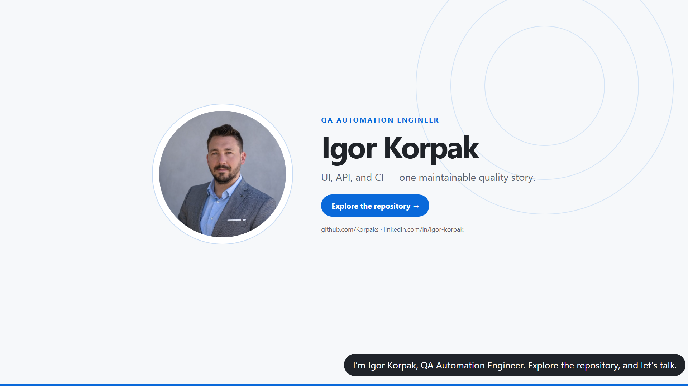
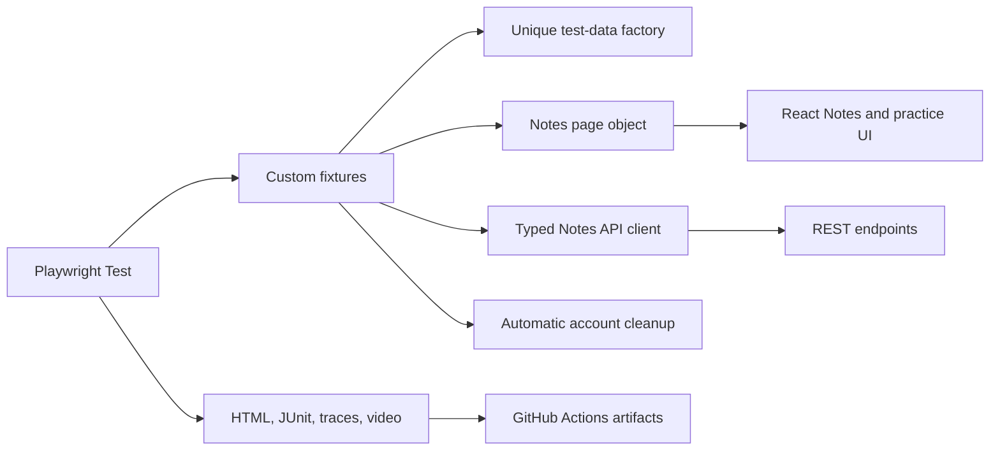

# Expand Testing Playwright Portfolio

[](https://github.com/Korpaks/expandtesting-playwright-qa-portfolio/actions/workflows/playwright.yml)

A maintainable QA automation portfolio built with **TypeScript** and **Playwright Test**, targeting only the public [Expand Testing practice platform](https://practice.expandtesting.com/). The suite demonstrates modern browser automation, React user journeys, REST API contract testing, isolated test data, and CI diagnostics.

## Quality evidence at a glance

| Signal | Evidence |
|---|---|
| Automated coverage | 30 independent UI and API tests with explicit assertions |
| CI execution | [GitHub Actions quality suite](https://github.com/Korpaks/expandtesting-playwright-qa-portfolio/actions/workflows/playwright.yml) |
| Failure diagnostics | HTML report, JUnit XML, screenshots, video, and Playwright traces |
| Test isolation | Unique synthetic users plus automatic account cleanup |
| Live proof | [60-second browser demo](https://korpaks.github.io/expandtesting-playwright-qa-portfolio/) |

## Watch the 60-second demo

<p align="center">
  <a href="https://korpaks.github.io/expandtesting-playwright-qa-portfolio/">
    
  </a>
</p>

<p align="center">
  <strong><a href="https://korpaks.github.io/expandtesting-playwright-qa-portfolio/">▶ Play the full demo in your browser</a></strong>
</p>

## What this project demonstrates

- React Notes journeys: registration, authentication, note creation, and deletion.
- REST API coverage for health, authentication, profiles, Notes CRUD, authorization, and validation.
- Dropdowns, checkboxes, hover states, uploads, iframes, dialogs, popups, and keyboard input.
- Resilient handling of asynchronous controls and dynamically loaded DOM content.
- A page object for user journeys and an API client for reusable service operations.
- Independent users generated per stateful test and automatic account cleanup.
- GitHub Actions with HTML and JUnit reports, screenshots, videos, and traces.

## Test inventory

The suite contains **30 focused tests** across three layers:

| Area | Coverage | Tests |
|---|---|---:|
| Notes API | Health, register/login, profile, CRUD, auth, validation | 11 |
| React Notes UI | Register, negative login, login/logout, create, delete | 5 |
| UI interactions | Dropdown, checkbox, hover, upload, iframe, dialogs, windows | 9 |
| Dynamic behavior | Async controls/loading, dynamic elements, keyboard | 5 |

Each test owns its data and can run independently. Stateful Notes tests create unique `example.com` users; the fixture deletes those accounts during teardown. No real credentials or secrets are stored in the repository.

## Project structure

```text
src/
  api/              Typed Notes API client
  data/             Unique, non-secret test data factories
  fixtures/         Playwright fixtures and automatic cleanup
  pages/            React Notes page object
tests/
  api/              REST API tests
  notes-ui/         React Notes user journeys
  ui/               Browser interaction and dynamic behavior tests
.github/workflows/  GitHub Actions pipeline
```

## Architecture



## Run locally

Requirements: Node.js 20+ (Node 22 recommended).

```bash
npm ci
npx playwright install chromium
npm test
```

Useful commands:

```bash
npm run test:api
npm run test:ui
npm run test:headed
npm run typecheck
npm run report
```

## Reliability and test design

- Assertions verify user-visible state or API contracts, not merely successful clicks or HTTP calls.
- Playwright locators favor roles, labels, and stable test IDs.
- Dynamic tests rely on web-first assertions instead of fixed sleeps.
- Tests run in parallel without sharing accounts or note IDs.
- Negative tests use harmless invalid inputs and never probe destructive or security-sensitive behavior.
- Failed CI runs retain a trace, screenshot, and video; the HTML report is uploaded on every run.

## Reports and debugging

After a local run, open the report with `npm run report`. For a CI failure, download the `playwright-report` or `test-results` artifact. Open a trace with:

```bash
npx playwright show-trace path/to/trace.zip
```

## Scope decisions

This repository intentionally targets one platform so UI and API coverage form a coherent portfolio story. Chromium is the default to keep public CI fast and deterministic. Allure is optional: Playwright HTML and JUnit reports already provide rich diagnostics with fewer moving parts.

## Known boundaries and tradeoffs

- The project validates a public practice service, so availability and behavior remain outside this repository's control.
- CI intentionally uses Chromium only; cross-browser depth is demonstrated in the separate Toolshop portfolio.
- Automated checks do not replace exploratory, visual, accessibility, performance, or security testing.
- Negative coverage stays within harmless validation and authorization cases; it is not penetration testing.
- Test counts communicate scope, not quality by themselves—the suite prioritizes independent scenarios and meaningful assertions.

## Responsible use

The target is a public practice environment. The suite limits CI concurrency, creates only isolated synthetic data, performs cleanup, and contains no employer code, personal data, tokens, or credentials.

## License

MIT
